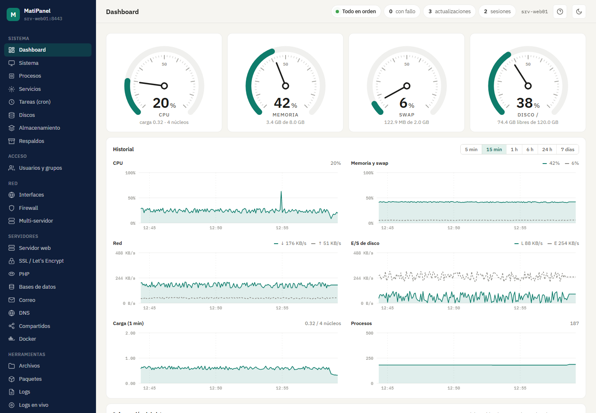
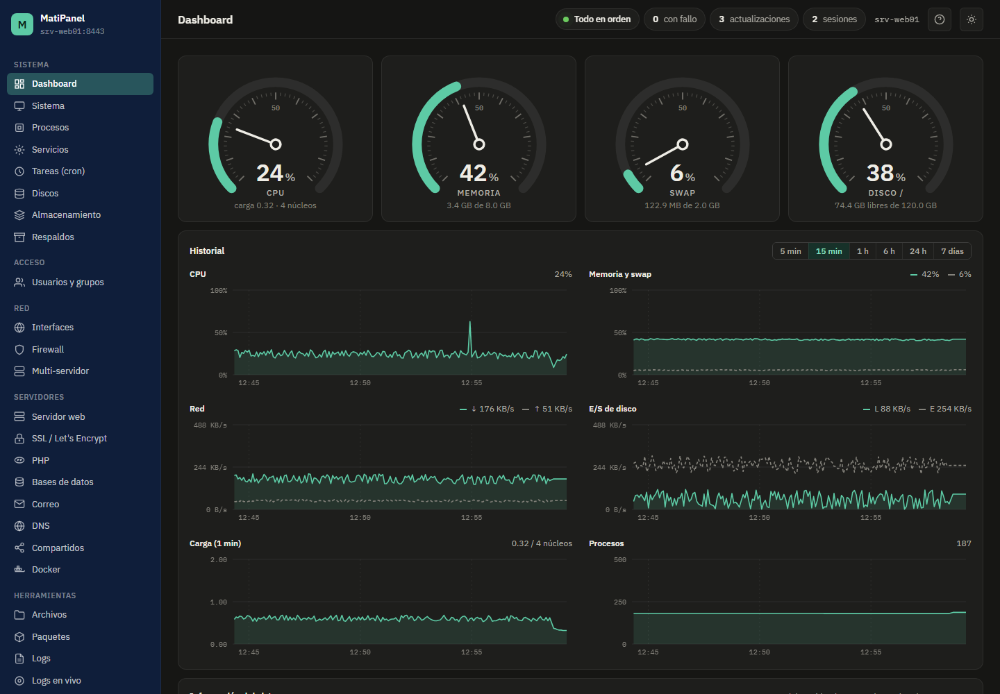
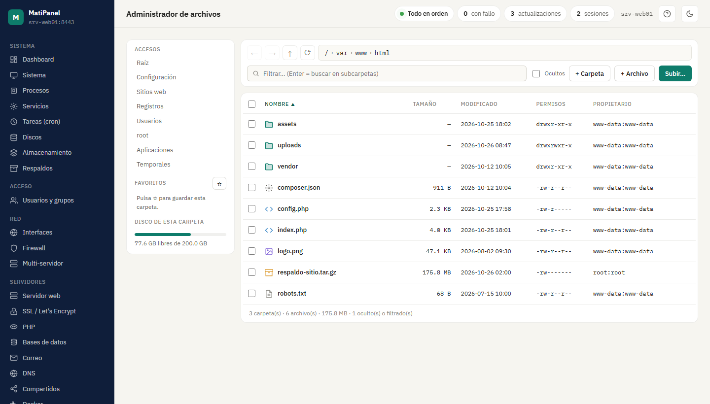
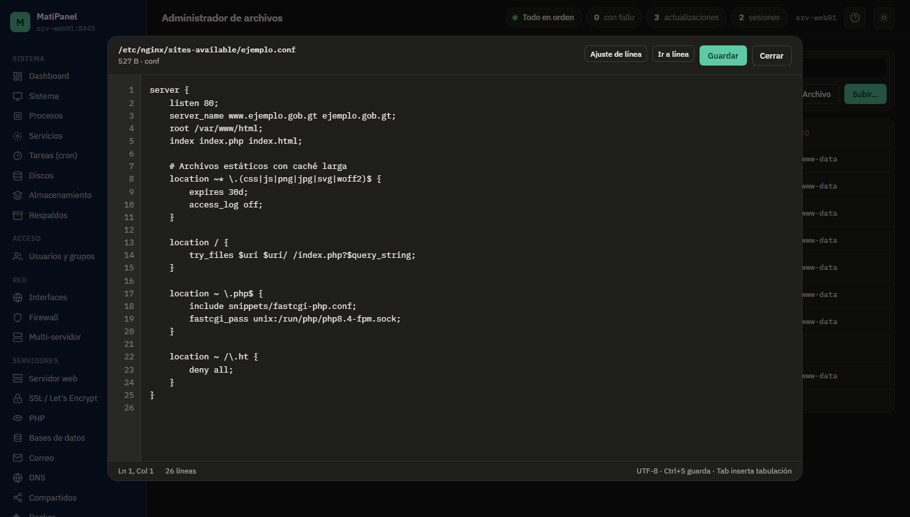
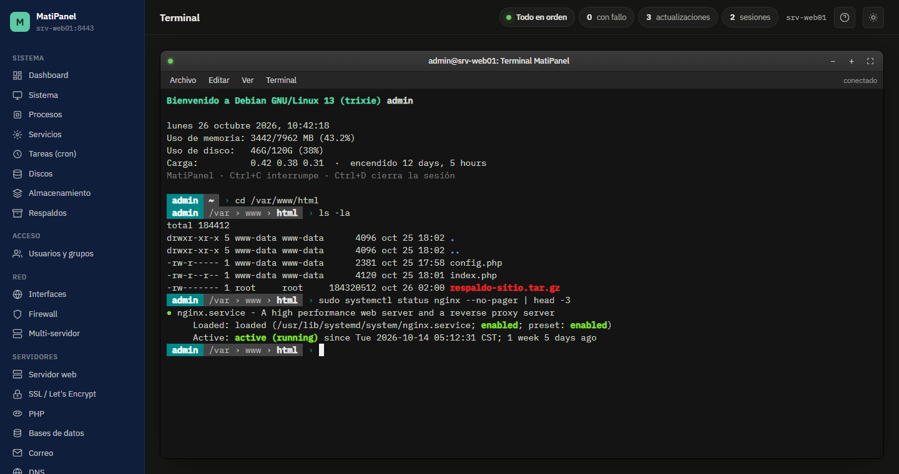
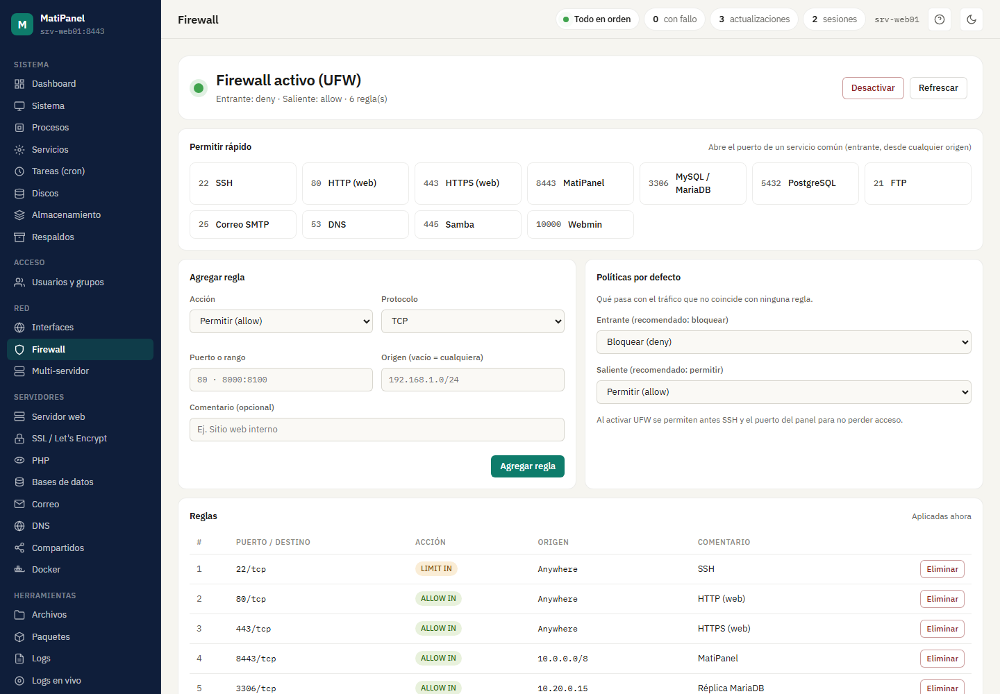
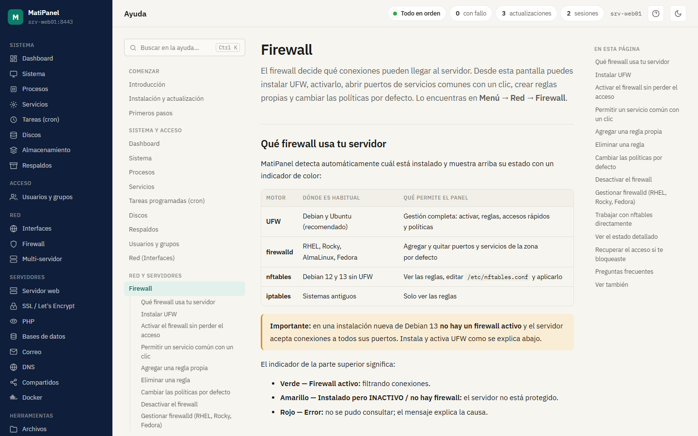
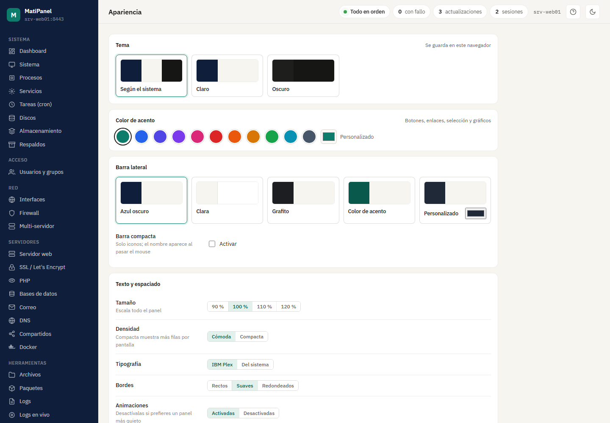
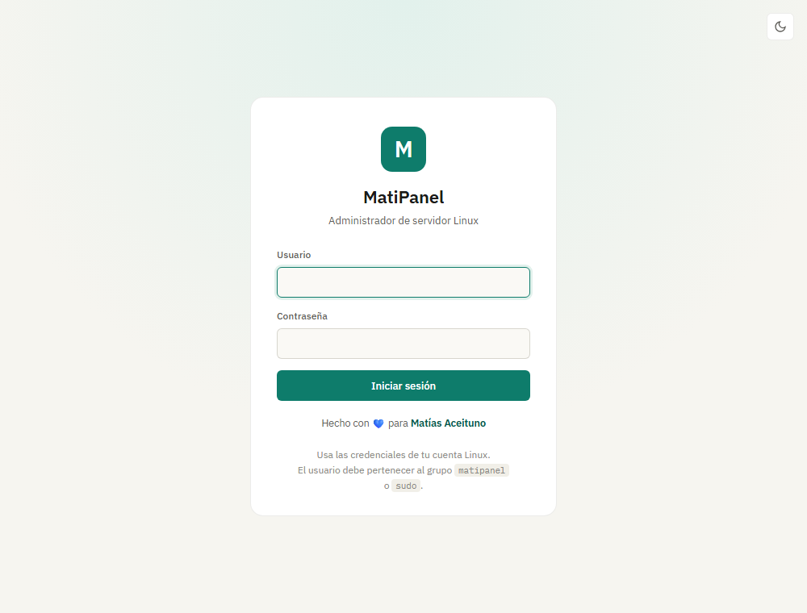

# MatiPanel

> Administrador web para servidores Linux, inspirado en Webmin y Cockpit, hecho con Python + Flask.

Administra tu servidor Debian desde el navegador: estado del sistema, servicios, usuarios, archivos, firewall, sitios web, PHP, bases de datos, correo, DNS, recursos compartidos, almacenamiento y más. Incluye terminal web, historial de métricas de 7 días, ayuda integrada con buscador y tema claro/oscuro.




---

## Capturas

<table>
  <tr>
    <td width="50%"><br><sub><b>Dashboard (tema oscuro):</b> tacómetros e historial de hasta 7 días; el estado del servidor se ve arriba en todas las pantallas.</sub></td>
    <td width="50%"><br><sub><b>Archivos:</b> favoritos, selección múltiple, copiar/cortar/pegar, búsqueda y menú contextual.</sub></td>
  </tr>
  <tr>
    <td><br><sub><b>Editor:</b> números de línea, posición del cursor, ajuste de línea y respaldo automático al guardar.</sub></td>
    <td><br><sub><b>Terminal:</b> shell real con tu usuario, estilo Linux Lite, con banner y prompt por segmentos.</sub></td>
  </tr>
  <tr>
    <td><br><sub><b>Firewall:</b> instala y gestiona UFW, con accesos rápidos para servicios comunes.</sub></td>
    <td><br><sub><b>Ayuda:</b> 30 capítulos con índice, buscador (Ctrl+K) y ayuda contextual.</sub></td>
  </tr>
  <tr>
    <td><br><sub><b>Apariencia:</b> color de acento, barra lateral, tamaño, densidad y secciones del dashboard, por usuario.</sub></td>
    <td><br><sub><b>Inicio de sesión:</b> con tus usuarios de Linux (PAM) y doble factor opcional.</sub></td>
  </tr>
</table>

## Módulos

### Sistema y acceso

| Módulo | Qué puedes hacer |
|---|---|
| **Dashboard** | Estado del servidor siempre visible en la barra superior, tacómetros de CPU/memoria/swap/disco, historial persistente de 7 días (CPU, memoria, red, E/S de disco, carga, procesos), procesos top, almacenamiento y servicios con fallo |
| **Sistema** | Hostname, zona horaria/NTP, sesiones, hardware, reiniciar/apagar, edición de configuraciones clave (hosts, resolv, sshd) |
| **Procesos** | Lista estilo `htop`, filtro, terminar o forzar |
| **Servicios** | systemd: iniciar, detener, reiniciar, habilitar al arranque, ver estado |
| **Tareas (cron)** | Crontabs por usuario: crear, editar, activar/desactivar, borrar |
| **Discos** | Particiones y uso |
| **Almacenamiento** | LVM (PV, VG, LV, snapshots), RAID con mdadm y cuotas de disco |
| **Respaldos** | Respaldos `.tar.gz` de carpetas, descarga, restauración y programación con retención |
| **Usuarios y grupos** | Crear/borrar usuarios, contraseñas, bloqueo, shells, grupos y membresías |

### Red y servidores

| Módulo | Qué puedes hacer |
|---|---|
| **Interfaces** | Interfaces de red y conexiones activas |
| **Firewall** | UFW (instalación con un clic, reglas, accesos rápidos, políticas), firewalld y nftables |
| **Multi-servidor** | Monitorea otros MatiPanel desde uno solo, con tokens de solo lectura y huella de certificado anclada |
| **Servidor web** | Apache y Nginx: sitios, asistente de virtual hosts, módulos, recarga con prueba previa |
| **SSL / Let's Encrypt** | Certificados con certbot: emitir, renovar, borrar |
| **PHP** | Versiones, `php.ini`, extensiones, PHP-FPM y pools |
| **Bases de datos** | MariaDB/MySQL y PostgreSQL: bases, usuarios, permisos, consola SQL, respaldo y restauración |
| **Correo** | Postfix y Dovecot: configuración, cola, alias, SSL, registro y correo de prueba |
| **DNS** | BIND 9: zonas primarias, inversas y secundarias, registros, SOA, reenviadores y pruebas con `dig` |
| **Compartidos** | Samba (recursos, usuarios, sesiones) y NFS (exports) |
| **Docker** | Contenedores, imágenes, volúmenes y logs |

### Herramientas y cuenta

| Módulo | Qué puedes hacer |
|---|---|
| **Archivos** | Navegar con favoritos y migas, seleccionar varios, copiar/cortar/pegar, comprimir (`.tar.gz`/`.zip`), extraer, permisos con casillas, buscar en subcarpetas, vista previa de imágenes, calcular tamaño de carpetas, subir arrastrando (incluso carpetas) y editor con números de línea |
| **Paquetes** | Buscar, instalar, quitar y actualizar (APT), actualizaciones automáticas |
| **Logs** | journalctl, archivos de `/var/log` y vista en vivo |
| **Terminal** | Shell real en el navegador con tu usuario (nunca root) |
| **Seguridad** | 2FA TOTP (Google Authenticator, Aegis…) con códigos de recuperación |
| **Apariencia** | Tema, color de acento, barra lateral, tamaño, densidad, bordes, tipografía y secciones del dashboard |
| **Ayuda** | Guía de usuario completa con índice, buscador y botón **?** en cada pantalla |

## Instalación en Debian

Requisitos: Debian 12 o 13 (o Ubuntu 22.04+), acceso root e internet durante la instalación.

```bash
# En el servidor, como root (su -  o  sudo -i)
apt update && apt install -y git
git clone https://github.com/DeathPaul1125/matipanel.git /tmp/matipanel
cd /tmp/matipanel
bash scripts/install.sh TU_USUARIO
```

`TU_USUARIO` es la cuenta Linux con la que entrarás al panel; el instalador la agrega al grupo `matipanel`. Al terminar, abre en el navegador:

```
https://IP-DEL-SERVIDOR:8443
```

El navegador avisará que el certificado es autofirmado: es lo esperado. Elige **Avanzado → Continuar** y entra con tu usuario y contraseña de Linux.

El instalador:

1. Instala las dependencias del sistema (`python3-venv`, compiladores, `openssl`, `zip`, `unzip`).
2. Crea el grupo `matipanel` y agrega a tu usuario.
3. Copia la aplicación a `/opt/matipanel` con su propio entorno de Python.
4. Genera un certificado HTTPS autofirmado en `/etc/matipanel/`.
5. Configura PAM (`/etc/pam.d/matipanel`) e instala el servicio systemd `matipanel`.

Para usar otro puerto: `MATIPANEL_PORT=9443 bash scripts/install.sh TU_USUARIO`. Si tienes firewall activo, abre el puerto (`ufw allow 8443/tcp`).

### Actualizar

```bash
cd /tmp/matipanel && git pull && bash scripts/install.sh
```

Recarga el navegador con **Ctrl+F5**. Se conservan el certificado, el 2FA, las preferencias, el historial de métricas y los respaldos.

### Desinstalar

```bash
bash scripts/uninstall.sh
```

### Si algo falla

```bash
systemctl status matipanel --no-pager
journalctl -u matipanel -n 60 --no-pager
```

La ayuda integrada tiene un capítulo completo de [solución de problemas](app/docs/90-solucion-de-problemas.md).

## Seguridad

El servicio corre como **root** (igual que Webmin) porque administra el sistema completo. Por eso el acceso está muy restringido:

- **Login con PAM:** usa tus usuarios Linux. Solo entran los miembros de los grupos `matipanel`, `sudo`, `wheel` o `admin`; root no puede entrar directamente.
- **Bloqueo de intentos:** 5 intentos fallidos (login o 2FA) bloquean la IP durante 5 minutos.
- **2FA TOTP opcional:** si su configuración se daña, el acceso se bloquea en lugar de saltarse el segundo factor.
- **Sesión y cookies:** HTTPS, cookie `__Host-` con `Secure`, `HttpOnly` y `SameSite=Lax`; la sesión se renueva al iniciar sesión y caduca tras 1 hora sin actividad. El código 2FA no se puede reutilizar y tiene su propio límite de intentos por usuario.
- **CSRF y WebSocket:** toda acción que modifica algo exige `Origin`/`Referer` del propio panel; los WebSocket (terminal, logs) verifican el origen.
- **Cabeceras de seguridad:** Content-Security-Policy (sin scripts externos ni envío de datos a otros sitios), `frame-ancestors 'none'` contra clickjacking, `nosniff`, `no-referrer` y `no-store` en las respuestas de datos.
- **Archivos y enlaces simbólicos:** las escrituras, subidas, extracciones y respaldos no siguen enlaces simbólicos plantados por otros usuarios; los comprimidos se revisan antes de extraer (rutas fuera del destino, setuid, dispositivos).
- **Terminal:** baja a los privilegios de tu usuario; nunca abre un shell root.
- **Comandos:** todos se ejecutan sin shell y con validación estricta de parámetros.
- **Acciones destructivas:** piden confirmación, y las más delicadas exigen escribir el nombre de lo que se va a borrar.
- **Cambios de configuración:** se validan antes de aplicarse (`nginx -t`, `testparm`, `named-checkzone`, `postfix check`…) y se revierten si fallan.

> No expongas el puerto 8443 a internet. Limítalo a tu red interna o a una VPN con el firewall.

## Dar acceso a otro usuario

```bash
usermod -aG matipanel <usuario>
```

Para quitarlo: `gpasswd -d <usuario> matipanel`. Su sesión se cierra en la siguiente acción que haga en el panel.

## Opciones

Se configuran con `systemctl edit matipanel`:

```ini
[Service]
Environment="MATIPANEL_FILE_WRITE=0"   # administrador de archivos en solo lectura
```

## Documentación

La guía de usuario completa (30 capítulos) está en [`app/docs/`](app/docs/) y dentro del panel en **Menú → Cuenta → Ayuda**, o con el botón **?** de cada pantalla. Empieza por la [Introducción](app/docs/01-introduccion.md) y la guía de [Instalación](app/docs/02-instalacion.md).

## Desarrollo

```bash
./scripts/run-dev.sh
```

Levanta el panel en `http://127.0.0.1:8080`, sin HTTPS y con tu usuario: las funciones que requieren root fallarán. Para trabajar contra un servidor remoto usa un túnel: `ssh -L 8080:localhost:8080 usuario@servidor`.

```
matipanel/
├── app/
│   ├── __init__.py       # Flask factory, CSRF por Origin, preferencias
│   ├── auth.py, totp.py  # Login PAM, 2FA y bloqueo de intentos
│   ├── metrics.py        # Historial de métricas (SQLite, 7 días)
│   ├── prefs.py          # Apariencia por usuario
│   ├── modules/          # Un blueprint por módulo
│   ├── templates/        # Jinja2
│   ├── static/           # CSS, JS (diálogos, gráficos), xterm.js, fuentes IBM Plex
│   └── docs/             # Guía de usuario (Markdown)
├── docs/screenshots/     # Capturas del README
├── scripts/              # install.sh, uninstall.sh, run-dev.sh
├── systemd/matipanel.service
├── wsgi.py
└── requirements.txt
```

## Roadmap

- [x] Gestión de correo (Postfix/Dovecot)
- [x] DNS (BIND)
- [x] Samba / NFS
- [x] Cuotas de disco y RAID/LVM
- [x] Multi-servidor
- [ ] DNSSEC y zonas inversas IPv6
- [ ] Buzones virtuales de correo

## Licencia

MIT. Ver [LICENSE](LICENSE).

---

<p align="center">Hecho con 💙 para <b>Matías Aceituno</b>, la inspiración de este proyecto.</p>
